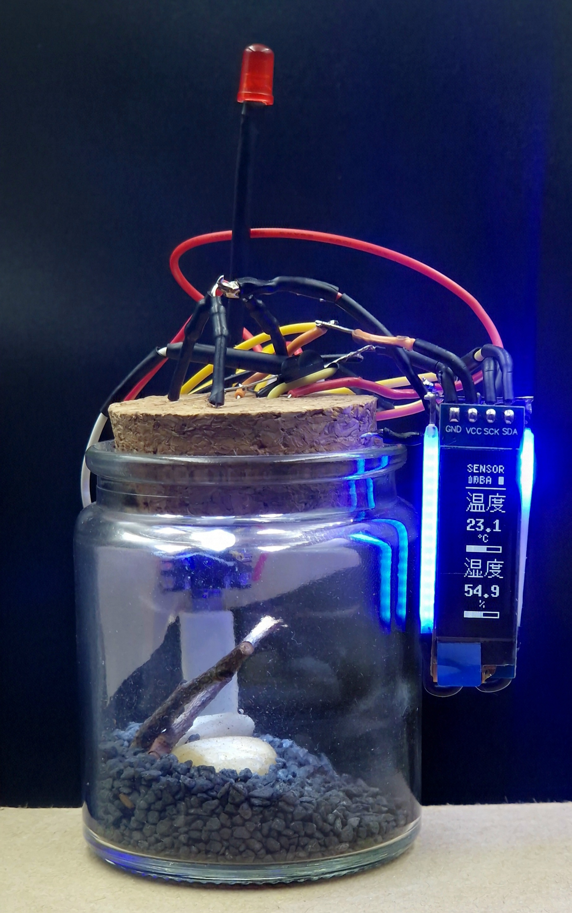
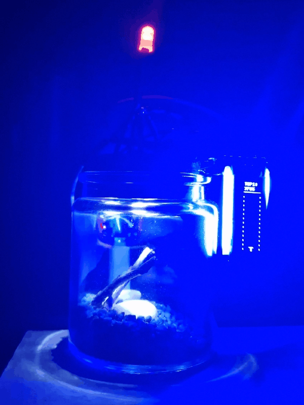
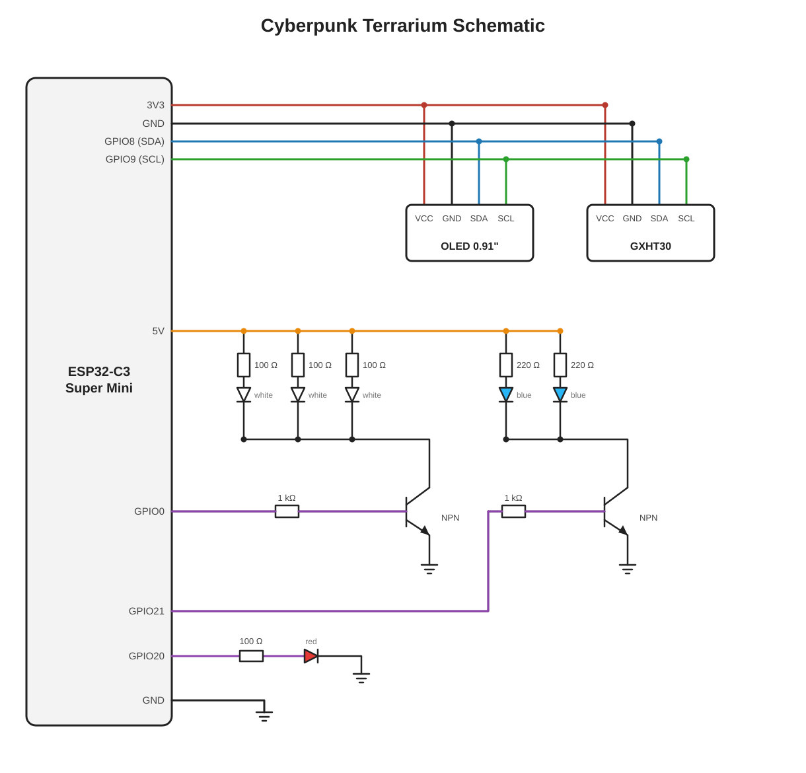

# Cyberpunk Terrarium

<p align="center">
  
  <br><sub>Final Project</sub>
</p>


## About

**Cyberpunk Terrarium** is my vision of what objects like this would look like in a cyberpunk world.

A neon display on the side of the jar, most likely hacked by immoral corporations, shows ads and only occasionally reveals the real data from the terrarium. Unstable, scavenged LEDs light the plants inside. Like old fluorescent tubes, they struggle to light up the organic greenery that this world has all but forgotten.

This is **version zero** and I will keep improving it. Next up is the "cable mess". It was meant to be an artistic choice, but it got out of hand. In future versions I will plan the wiring better, move most of it onto a PCB and keep the rest as purely decorative, do-nothing styling.

If this repository inspired you to build something similar, please leave a star ⭐ and mention me in your project. I would be very grateful!

## 🎬 Demo

[](assets/demo.mp4)

<sub> Click to open the full video ([assets/demo.mp4](assets/demo.mp4)).</sub>

---

A cyberpunk-style, scrap-built terrarium project: a jar with a glitching vertical OLED display, flickering fluorescent-style LEDs, neon-like side lighting, a blinking red warning beacon and a temperature/humidity readout.

The firmware is in [`cyberpunk_terrarium/cyberpunk_terrarium.ino`](cyberpunk_terrarium/cyberpunk_terrarium.ino).

## Hardware and wiring

<table>
<tr>
<td valign="top" width="34%">

- ESP32-C3 Super Mini
- SSD1306 0.91" OLED (128x32)
- GXHT30 humidity and temperature sensor
- GPIO0: white LEDs x3 inside the jar, imitating old fluorescent tube lamps
- GPIO21: blue filament LEDs x2, side lighting of the screen simulating neon signs
- GPIO20: red LED x1, a beacon / warning light like the ones on top of buildings
- Resistors: 100 Ω x3, 220 Ω x2
- NPN transistors x2
- Jar of your choice x1
- 5 V power source

</td>
<td valign="top" width="66%">



</td>
</tr>
</table>

## Software

- Arduino IDE with ESP32 board support (both Arduino-ESP32 core 2.x and 3.x are supported; the code picks the right LEDC API automatically)
- Library: [U8g2](https://github.com/olikraus/u8g2)

### Font and flash size

The Japanese font is `u8g2_font_unifont_t_japanese3` (most kanji, uses more flash). If compilation complains about size, switch `JP_FONT` to `u8g2_font_unifont_t_japanese2`.

## Configuration

All settings are `#define`s / constants near the top of each section of the sketch.

| Name | Description |
|------|-------------|
| `SDA_PIN` / `SCL_PIN` | I2C pins (shared by the display and the sensor) |
| `ROTATION` | Display rotation; use `U8G2_R1` if the display is upside down |
| `SCROLL_STEP` | Pixels the text moves per frame (how fast it scrolls) |
| `FRAME_MS` | Frame time in ms |
| `JP_FONT` / `LATIN_FONT` | Fonts for Japanese and Latin characters |
| `SENSOR_EVERY_MS` | Minimum interval between readings screens; the readings appear after the current message ends |
| `SENSOR_SHOW_MS` | How long the readings screen stays |
| `SENSOR_PRE_MS` | The measurement is taken this long before it is shown |
| `FLUORO_PIN` | PWM pin of the white inside LEDs |
| `FLUORO_PWM_FREQ` | PWM frequency of the inside LEDs |
| `FLUORO_BASE` | Steady-state brightness of the fluorescent LEDs (0-255) |
| `NEON_PIN` | The 2 blue filament LEDs (neon side lighting) that glitch together with the screen (HIGH = on) |
| `NEON_BASE` | Brightness of those LEDs when not glitching (0-255) |
| `BEACON_PIN` | Red beacon |
| `BEACON_PERIOD` | Time per flash |
| `BEACON_MAX` | Maximum beacon brightness |

The display is mounted rotated, so the logical size used in the code is `W` = 32 by `H` = 128 pixels. `CELL` (16 px) is the height of one character cell and `HEADER_H` (21 px) is the height of the header.

## Messages

Messages are defined in the `msgs[]` array as `{ "TAG", "body" }`:

```cpp
const Msg msgs[] = {
  { "EX1", "サンプル 一 ここに 文章を 入れます" },   // Japanese only
  { "EX2", "これは|~EXAMPLE|~TWO|です" },            // Japanese mixed with Latin segments
  { "EX3", "~EXAMPLE|~THREE|~HELLO|~WORLD" },        // Latin only, several segments
};
```

Message format (the `body` field):

| Syntax | Meaning |
|--------|---------|
| `~TEXT` | Latin text, one letter per row, centered (shop names etc.). A segment ends at `\|` or at the end of the string |
| anything else | Japanese text, vertical, one character per row |
| space | small gap |
| `\|` | gap between segments |
| `ー` | drawn as a vertical bar |

The `tag` (max 6 characters) is shown in the header at the top.

A random message is chosen at start and, when it finishes scrolling, the next one is picked at random (never the same one twice in a row if there is more than one message). Up to `MAX_IT - 1` (109) characters per message are laid out.

## How it works

### Message layout

`loadMsg()` parses a message body into a list of drawable items (position relative to the start of the message, kind, offset and length in the string). Kind `0` is a Japanese character, kind `1` is a Latin letter. `drawBody()` then draws only the items that are currently on screen.

### Display, glitch and header

- The sides of the screen have animated dashed rails.
- During a glitch, a "ghost" copy of the text is drawn with a small random offset.
- The header shows the tag (sometimes corrupted by random junk characters during a glitch), a changing hex code and a blinking block.
- Glitch effects: pages (8-pixel rows) of the display buffer are shifted sideways (`shiftPage()`), XOR boxes and lines are drawn, random pixels are added, the contrast jumps, and sometimes the screen goes completely black (blackout).
- `scheduleGlitch()` plans the next glitch; occasionally a short "burst" follows quickly after the previous one.

### Boot intro

At power-on a glitching "BOOT v2.077" screen with the Japanese text 起動中 ("booting") is shown.

### Sensor (GXHT30)

The sensor sits on the same I2C pins as the display. Its address (0x44 or 0x45) is detected automatically at start. The sketch uses single-shot, high-repeatability measurement (command `0x24 0x00`) and checks the CRC of both values.

The readings screen shows temperature (温度) and humidity (湿度) with a level bar each (temperature scale is 0-40 °C). If the sensor does not respond, `--.-` and the `NO SNS` tag are shown instead.

Timing: the measurement is taken at the last moment before the current message ends (about `SENSOR_PRE_MS` before), not continuously. When the message ends and a measurement is ready, the readings screen is shown before the next message. The first readings screen appears after about 10 seconds.

### Fluorescent-lamp LEDs (GPIO0)

The 3 white LEDs inside the jar imitate old fluorescent tube lamps (flickering, struggling to ignite). They are driven through a transistor:

- GPIO0 → resistor (1-4.7 kΩ recommended, but not strictly needed) → BC647 base
- emitter → GND
- collector → LED cathodes (anodes through resistors of about 100 Ω to 5 V)

Behavior:

- **Ignition** at power-on (like a tube warming up): a long series of "ignition attempts", each step more likely to be bright, ending fully lit.
- **Steady state**: brightness around `FLUORO_BASE` with a slight "buzz", and occasional flicker bursts (dark / dim / bright).
- **Rarely**, the lamp goes out completely and tries to ignite again.

The fluorescent effect is updated on every loop iteration, independent of the display frame rate.

### Extra LEDs

- **GPIO21** (2 blue filament LEDs, side lighting of the screen simulating neon signs): flicker randomly while the screen glitches, steady at `NEON_BASE` otherwise; off during a blackout.
- **GPIO20** (red beacon): fast rise, short hold, fade out, then a pause.
